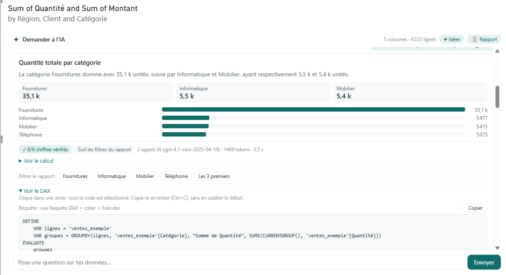
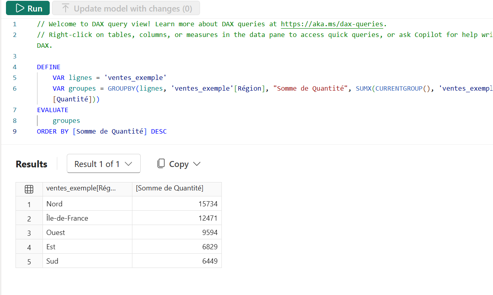
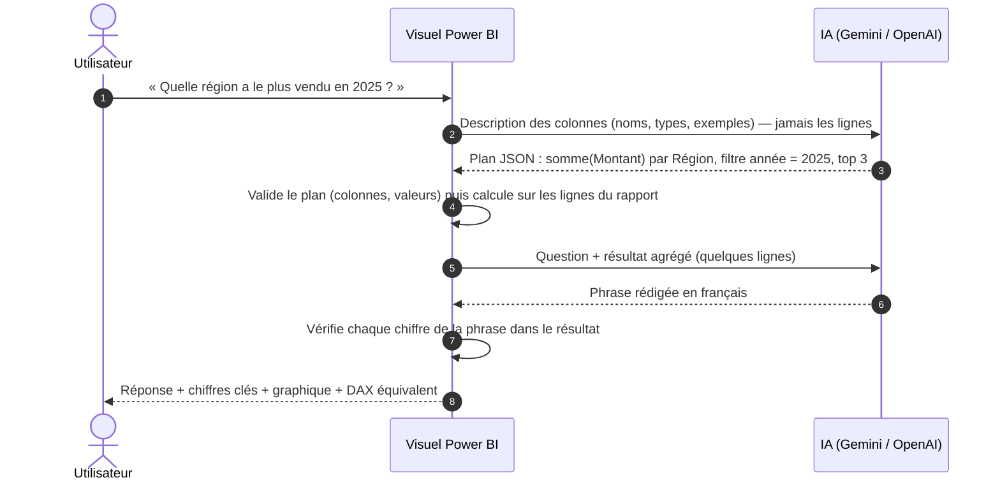

<div align="center">

# ✦ Assistant IA pour Power BI

**Posez une question en français à votre rapport Power BI. Obtenez une réponse chiffrée, vérifiée, et le code DAX qui la prouve.**

*L'IA ne voit jamais vos données. Elle ne peut pas inventer un chiffre.*


[Démo](#-démo) · [L'assistant](#-lassistant) · [Architecture](#-architecture) · [Choix techniques](#-choix-techniques) · [Installation](#-installation-en-5-minutes)

</div>

---

## 🎯 L'assistant

L'Assistant IA est un visuel que l'on ajoute à un rapport Power BI. On lui pose une question en français sur les données du rapport, et il répond par une phrase, des chiffres clés et un graphique.

Son travail, à chaque question :

1. **Comprendre la question** : l'IA reçoit la description des colonnes (jamais les lignes) et choisit le calcul à faire.
2. **Calculer** : le visuel vérifie ce calcul puis l'exécute lui-même, sur les données du rapport.
3. **Répondre** : l'IA rédige la phrase à partir du résultat.
4. **Vérifier** : chaque chiffre de la phrase est comparé au résultat ; un chiffre introuvable est signalé.
5. **Prouver** : le calcul est fourni en DAX, pour le refaire dans Power BI et retrouver les mêmes chiffres.

## 🎬 Démo

**Une question, une réponse vérifiée (6/6 chiffres), des boutons pour filtrer le rapport, et le DAX qui la prouve :**



**La preuve : la requête DAX générée, exécutée dans Power BI, redonne les mêmes chiffres.**



## ✨ Fonctionnalités

| | Fonction | En pratique |
|---|---|---|
| 💬 | **Questions en français** | « Top 3 des régions en 2025 ? », puis « Et en 2024 ? » : l'assistant garde le contexte. |
| 💡 | **Propositions d'analyses** | À l'ouverture, il résume le jeu de données et propose 5 analyses pertinentes, à lancer d'un clic. |
| ✅ | **Chiffres vérifiés** | Badge « 3/3 chiffres vérifiés » sous chaque réponse ; une réécriture automatique si un chiffre ne colle pas. |
| 🚫 | **Refus honnête** | « Quelle est la marge ? » sans colonne de marge → « Pas dans tes données », avec des questions faisables. |
| 🎛️ | **Filtrer le rapport** | Sous une réponse, « Filtrer le rapport : Nord » filtre tous les graphiques de la page. |
| 🧮 | **Voir le DAX** | Requête prête pour la vue Requête DAX, et mesures prêtes pour le modèle. |
| 📋 | **Rapport d'analyse** | Synthèse neutre de toute la session (constats chiffrés, sans jugement ni recommandation), à copier dans Word. |
| 🔌 | **Gemini ou OpenAI** | Le fournisseur est reconnu à la clé (`AIza…` ou `sk-…`), avec bascule automatique entre modèles en cas de surcharge. |

## 🏗 Architecture



Si le plan est invalide (colonne inexistante, valeur inconnue), le visuel renvoie l'erreur précise à l'IA, qui corrige une fois. Si un chiffre de la phrase est introuvable, l'IA réécrit une fois ; sinon, le chiffre est signalé à l'utilisateur.

## 🧠 Choix techniques

Ce qui distingue ce projet d'un simple « chat branché sur des données » :

- **Anti-hallucination par construction.** L'IA produit un *plan*, jamais un résultat. Un module de vérification extrait chaque nombre de la réponse (formats français : `1,93 M€`, `35,3 %`, `12 400`) et le confronte aux valeurs du calcul, à leurs écarts, ratios et pourcentages, à l'arrondi près.
- **Confidentialité par conception.** Seuls le schéma et des résultats agrégés quittent Power BI. Les segments et filtres du rapport s'appliquent avant tout calcul.
- **Un compilateur plan → DAX, sans IA.** Le plan validé est traduit de façon déterministe en requête DAX (`GROUPBY`, `TOPN`, `CURRENTGROUP`…) et en mesures `CALCULATE`, avec les vrais noms de tables et de colonnes du modèle. Le DAX ne peut donc pas « halluciner ».
- **Couche fournisseur interchangeable.** Gemini et OpenAI derrière une même interface, avec repli sur d'autres modèles, nouvelle tentative sur les erreurs passagères (429, 503), délai maximal par appel, et mise à l'écart temporaire d'un modèle saturé.
- **Zéro dépendance superflue.** Le rapport PDF est écrit à la main (format PDF, police Helvetica, tableaux et barres), sans bibliothèque. L'interface est construite sans `innerHTML` : rien de ce que renvoie l'IA n'est interprété comme du HTML.
- **Moteur testable hors de Power BI.** Calcul, vérification, DAX et rapport sont des modules TypeScript purs, testés dans Node sur un jeu de 6 000 lignes.
- **Ancré dans les contraintes réelles.** Le visuel tourne dans un iframe isolé de Power BI. Les téléchargements y sont souvent bloqués par les administrateurs, donc le rapport se copie au lieu de se télécharger.

## 🧰 Stack

**TypeScript** · **Power BI Visuals API 5.11** · **API Gemini** · **API OpenAI** · **DAX** · Less · Node.js (tests) · ESLint · esbuild

Environ 2 100 lignes de TypeScript réparties en 13 fichiers.

## 🚀 Installation en 5 minutes

1. **Une clé API** : Gemini gratuite sur [aistudio.google.com/apikey](https://aistudio.google.com/apikey), ou OpenAI sur [platform.openai.com/api-keys](https://platform.openai.com/api-keys).
2. **Importer le visuel** dans Power BI Desktop : *Visualisations* > `…` > *Importer un visuel à partir d'un fichier* > [`Assistant_IA_Power_BI.pbiviz`](Assistant_IA_Power_BI.pbiviz).
3. **Charger des données**, par exemple [`ventes_exemple.csv`](ventes_exemple.csv) (6 095 ventes, séparateur `;`).
4. **Glisser les champs** dans le visuel :
   - **Colonnes** : un identifiant de ligne (`IdVente`), `Date`, `Région`, `Catégorie`, `Canal`, `Client`
   - **Valeurs** : `Montant`, `Quantité`
5. **Coller la clé** : *Format du visuel* > *Assistant IA* > *Clé API (Gemini ou OpenAI)*.

> 💡 Mettez toujours un **identifiant de ligne** dans *Colonnes*, et choisissez le champ **Date** plutôt que la *Hiérarchie de dates*.

## 🛠 Développement

```bash
cd assistant-ia-source/assistant-ia
npm install
npm test                 # 13 tests : moteur de calcul, vérification, pipeline complet (IA simulée)
npx pbiviz package       # génère dist/*.pbiviz

cp .env.example .env     # puis ajoutez OPENAI_API_KEY ou GEMINI_API_KEY
npm run test:ia          # test de bout en bout avec la vraie IA, et rapport PDF dans tests/
```

<details>
<summary><b>Structure du code</b></summary>

```text
src/
├── visual.ts     point d'entrée Power BI : données, interface, filtres, rapport
├── pipeline.ts   orchestration : plan → calcul → phrase → vérification ; propositions ; synthèse
├── engine.ts     validation du plan et calcul (filtres, regroupements, périodes, agrégats)
├── guard.ts      extraction et vérification de chaque chiffre de la réponse
├── schema.ts     description des colonnes envoyée à l'IA (sans les lignes)
├── dax.ts        compilateur plan → requête DAX et mesures
├── rapport.ts    rapport en texte et en PDF, écrit sans bibliothèque
├── ia.ts         choix du fournisseur d'après la clé
├── gemini.ts     client Gemini et consignes (plan, phrase, idées, synthèse)
├── openai.ts     client OpenAI
└── ui.ts         cartes de réponse, chiffres clés, graphiques
tests/
├── test.ts       tests hors ligne sur ventes_exemple.csv
└── live.ts       test avec la vraie IA (clé lue dans .env, jamais versionné)
```

</details>

## ⚖️ Limites assumées

- Opérations : somme, moyenne, min, max, comptage, comptage distinct ; 0 à 2 regroupements ; filtres ; top N ; part du total. Pas de prévision ni d'explication des causes : les données ne les contiennent pas.
- L'IA ne voit que les champs glissés dans le visuel, pas tout le modèle.
- La clé API est stockée dans le fichier `.pbix`. Pour une démo, c'est acceptable ; en production, un petit serveur intermédiaire garderait la clé.
- Le DAX est généré pour les colonnes d'une même table, pas pour les mesures existantes.

## 🗺 Pistes d'évolution

- Serveur intermédiaire pour sortir la clé API du rapport
- Génération de la mesure DAX directement dans le modèle (`DEFINE MEASURE` + mise à jour du modèle)
- Support multi-tables (relations du modèle)
- Évaluation automatique de la qualité des plans sur un jeu de questions de référence

## 👩‍💻 Auteure

**Djamila** · étudiante à l'EPSI · [@mila1515](https://github.com/mila1515)

Projet mené de bout en bout : besoin, architecture, moteur de calcul, intégration Power BI et IA, tests. Développé avec Claude Code comme assistant de programmation.

---

<div align="center">
<sub>Licence MIT · Si ce projet vous intéresse, une ⭐ fait toujours plaisir.</sub>
</div>
